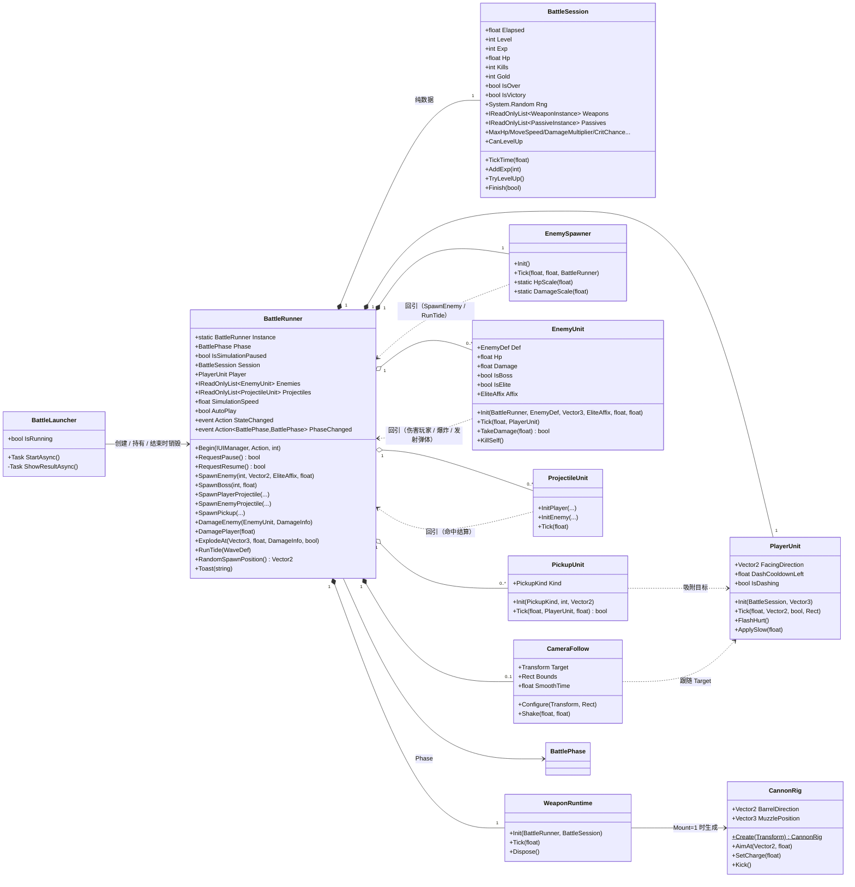
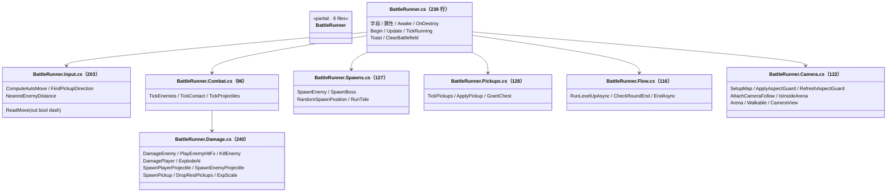
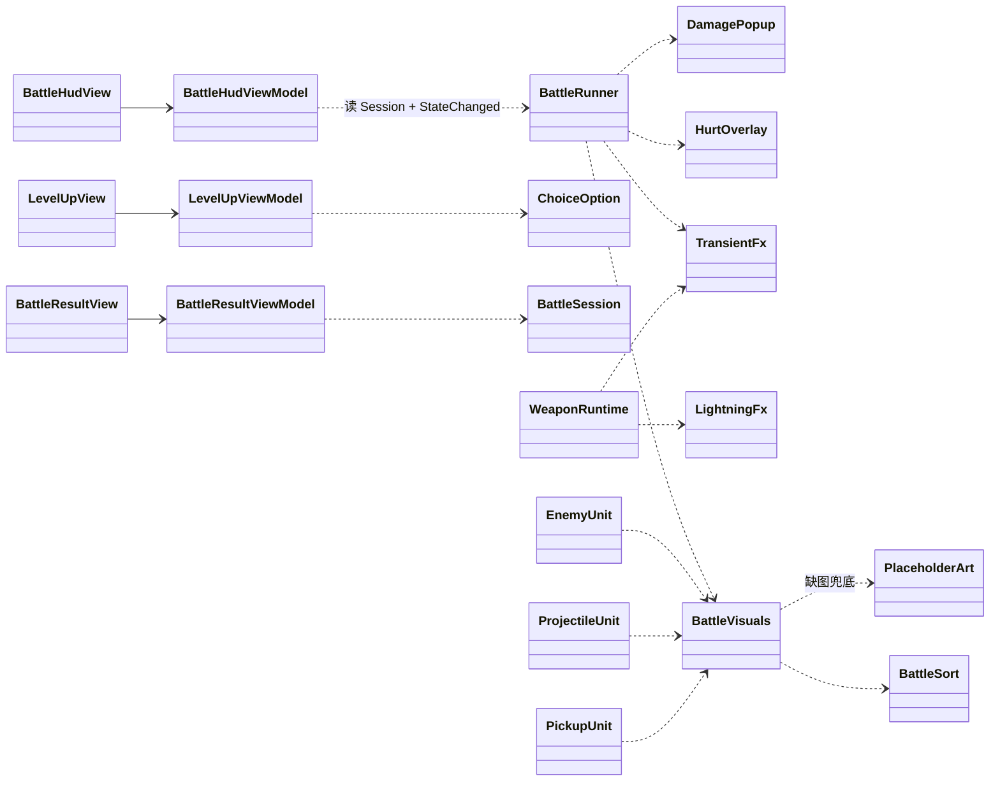
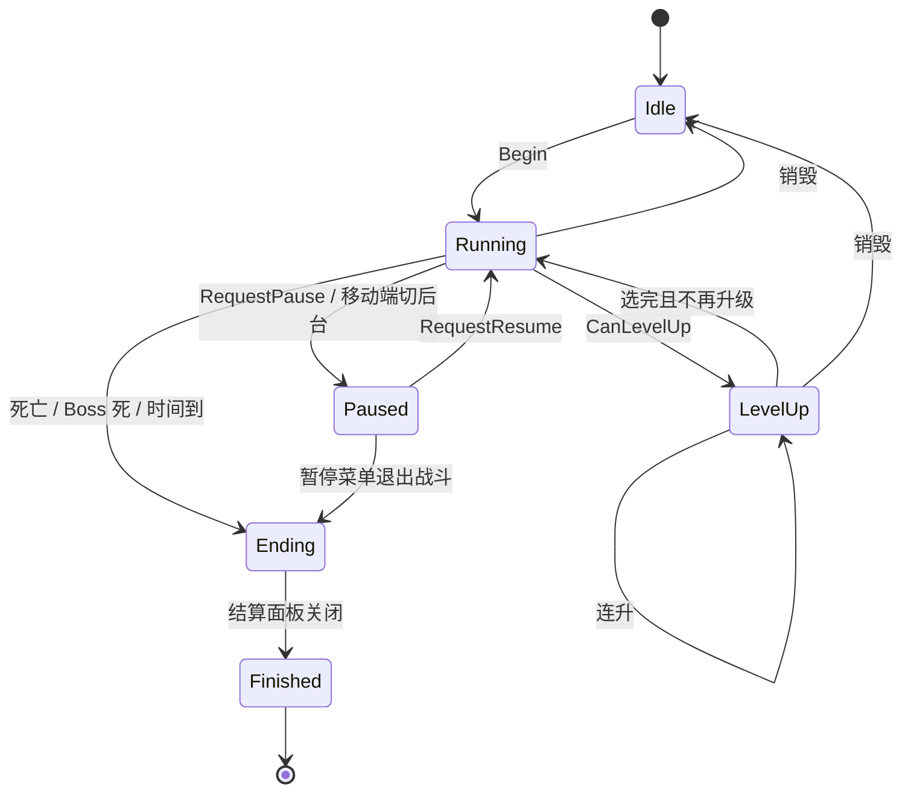
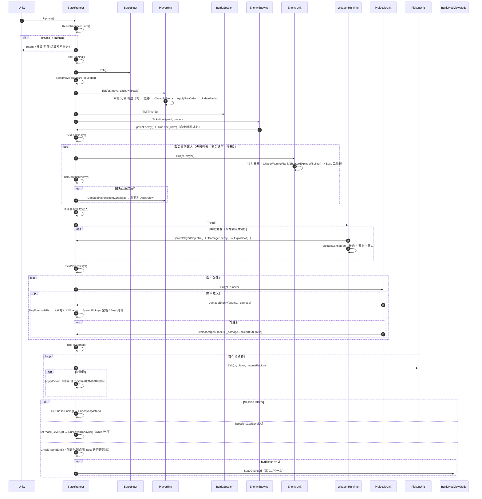

# 战斗系统类图

> 对应代码：`Client/Assets/App/Battle/`（33 个文件，其中 `BattleRunner` 的 8 个 partial 计 8 个）、
> `Client/Assets/App/UI/Battle/`（6 个界面）、`Client/Assets/App/Config/BattleDefs.cs`（配置类型）。
> 图用 Mermaid 写，GitHub / VS Code（Markdown Preview Mermaid）能直接渲染；下面每张图后面都有文字补充。

## 1. 总览（运行期对象关系）



**读法**：`*--` 是组合（runner 自己 new / AddComponent 并负责销毁），`o--` 是聚合（列表里随时增删），
`..>` 是"运行期回引"——也就是 P2 要抽 `IBattleContext` 抹掉的方向（Unit 目前都攥着一个 `BattleRunner` 字段）。

## 2. `BattleRunner` 的 partial 分部

一个类拆成 8 个文件，按职责分，**没有增加任何抽象层**，只是为了别让单文件超过 250 行：



## 3. 数据模型（配置 → 实例 → 派生属性）

```mermaid
classDiagram
    direction LR

    class ConfigRowBase~T~ {
        <<abstract, static registry>>
        +static All / Count
        +static Get(int) T
        +static Load(T[])
    }

    class EnemyDef {
        +int Id
        +string Name
        +EnemyBehavior Behavior
        +float Hp / Speed / Radius / Damage
        +int Exp / Gold
        +string Sprite / Color
        +float AttackInterval / AttackRange / ProjectileSpeed
        +float FuseTime / ExplodeRadius
        +float SlowOnHit
    }

    class WeaponDef {
        +int Id
        +string Name
        +WeaponKind Kind
        +int MaxLevel
        +float Damage / Cooldown / Area
        +int Projectiles
        +float ProjectileRadius
        +float Range / Duration
        +int Pierce / Count
        +int PassiveId / EvolvedId
        +int Mount
        +string Sprite
    }

    class PassiveDef {
        +int Id
        +PassiveKind Kind
        +int MaxLevel
        +float[] Values
    }

    class WaveDef {
        +float Time
        +WaveKind Kind
        +int EnemyId
        +int SpawnCount
        +float Interval / Duration
        +EliteAffix Affix
        +float Radius
    }

    class BattleSession {
        +...见上图
    }

    class WeaponInstance {
        +WeaponDef Def
        +int Level
        +float CooldownTimer {private set}
        +bool IsReady
        +AdvanceCooldown(float)
        +ResetCooldown(float)
        +ClearCooldown()
        +bool IsMaxLevel
        +bool IsEvolved
    }

    class PassiveInstance {
        +PassiveDef Def
        +int Level
        +bool IsMaxLevel
    }

    class EnemyUnit
    class PickupUnit

    ConfigRowBase <|-- EnemyDef
    ConfigRowBase <|-- WeaponDef
    ConfigRowBase <|-- PassiveDef
    ConfigRowBase <|-- WaveDef
    BattleSession "1" *-- "0..8" WeaponInstance
    BattleSession "1" *-- "0..10" PassiveInstance
    WeaponInstance --> WeaponDef
    PassiveInstance --> PassiveDef
    EnemyUnit --> EnemyDef : Def
    PickupUnit ..> PickupKind
```

`WeaponInstance` / `PassiveInstance` 是 `BattleSession.cs` 里的同文件类型；`EnemyDef` 等四个 Def 在
`Assets/App/Config/BattleDefs.cs`，由 `ConfigTables.LoadAsync` 从 `Assets/Res/Config/Battle/*.json` 装载。

## 4. 表现层（不受战斗逻辑直接依赖）



## 5. 流程状态机（详见 `Assets/App/Battle/战斗系统.md` 2.6）



`LevelUp → Ending` 被刻意禁止（升级期间模拟冻结，正常路径不可能分胜负）；出现即 `[Battle] illegal transition …` 告警。

## 6. 依赖方向的问题（P2 要解决的）

```
EnemyUnit     ─┐
ProjectileUnit ─┼─→ BattleRunner（具体类，拆成 8 个 partial、合计约 1300 行）
PickupUnit    ─┤       ↑
EnemySpawner  ─┘       │
WeaponRuntime ─────────┘
```

- 6 个类都持有 `BattleRunner` 具体类型，导致单独测 `EnemyUnit` 必须造一个真的 `BattleRunner`；
- `BattleRunner` 又反向持有它们的列表，双向引用。
- P2 的做法：抽 `IBattleContext`（`SpawnProjectile / DamageEnemy / DamagePlayer / ExplodeAt / SpawnPickup / Player / Enemies / Session`），
  Unit 只依赖接口；`BattleRunner` 实现它。策略接口（`IWeaponBehavior` / `IEnemyBehavior` / `IWaveStep` / `IPickupEffect`）
  再把 `WeaponKind` / `EnemyBehavior` / `WaveKind` / `PickupKind` 四处 switch 变成注册表。

## 7. 关键字段速查

只列真正影响行为的那几个字段（属性访问器见各源文件）。

```mermaid
classDiagram
    class BattleSession {
        +const float RoundDuration = 300
        +const int MaxWeaponSlots = 4
        +const int MaxPassiveSlots = 4
        +const int MaxLevel = 20
        +const int BossEnemyId = 100
        -List~WeaponInstance~ _weapons
        -List~PassiveInstance~ _passives
        -float _elapsed
        -int _level = 1
        -int _exp
        -float _hp
        -int _kills
        -int _gold
        -bool _over
        -bool _victory
        +System.Random Rng
    }

    class WeaponInstance {
        +WeaponDef Def
        +int Level
        +float CooldownTimer
        +bool IsMaxLevel
        +bool IsEvolved
    }

    class PassiveInstance {
        +PassiveDef Def
        +int Level
        +bool IsMaxLevel
    }

    class PlayerUnit {
        +const float Radius = 0.4
        +const float DashDistance = 2.5
        +const float DashDuration = 0.2
        +const float DashCooldown = 3
        -BattleSession _session
        -float _facingAngle
        -float _dashTimeLeft
        -float _dashCooldownLeft
        -float _invulnLeft
        -float _slowLeft
        -float _flash
    }

    class EnemyUnit {
        +EnemyDef Def
        +float Hp
        +float MaxHp
        +float Radius
        +float Damage
        +bool IsBoss
        +bool IsElite
        +EliteAffix Affix
        -BattleRunner _runner
        -float _speed
        -float _slowUntil
        -float _fuseLeft
        -float _attackTimer
        -float _flash
        -Vector2 _knockback
        +float NextContactTime
        +float NextBladeHitTime
    }

    class ProjectileUnit {
        -Vector2 _velocity
        -DamageInfo _damage
        -float _radius
        -int _pierce
        -float _splash
        -float _life
        -float _spin
        -EnemyUnit _homingTarget
        -HashSet~EnemyUnit~ _hit
    }

    class PickupUnit {
        +PickupKind Kind
        +int Value
        +bool Attracted
        -float _life = 90
    }

    class WeaponRuntime {
        -BattleRunner _runner
        -BattleSession _session
        -List~Blade~ _blades
        -List~Bomb~ _bombs
        -CannonRig _cannon
        -EnemyUnit _cannonTarget
        +const float CleaveSpread = 120
    }

    class EnemySpawner {
        -List~WaveDef~ _waves
        -Dictionary~int,float~ _timers
        -HashSet~int~ _fired
        +static HpScale(float) 1 + 0.4/min
        +static DamageScale(float) 1 + 0.2/min
    }

    class CannonRig {
        +Vector2 BarrelDirection
        +Vector3 MuzzlePosition
        +float Charge
        -float _angle
        -float _charge
        -float _recoil
        -float _flashLeft
        +const float SideDistance = 1.02
        +const float AngleSmoothTime = 0.22
    }

    BattleSession "1" *-- "0..4" WeaponInstance
    BattleSession "1" *-- "0..4" PassiveInstance
```



## 8. 一帧的调用时序（`BattlePhase.Running`）



要点：

- **遍历顺序固定**：玩家 → 时间 → 刷怪 → 敌人/接触 → 武器 → 弹体 → 拾取 → 结束判定。
  这个顺序决定了「同一帧内先挨打还是先吃到经验糖」，调手感时不要随意调换。
- 敌人列表和弹体列表都**先拷贝/倒序遍历再删**，因为 `KillEnemy` 里的爆炸与分裂会在遍历中增删元素。
- `DamagePopup`、`HurtOverlay`、`TransientFx` 用各自的 `Update` + `Time.unscaledDeltaTime`，不在这条链上，暂停时仍会播完。
- 升级与结算都是 `async` 面板流程，**不在本帧内完成**：`SetPhase` 立刻生效，模拟从下一帧起就停住了。


