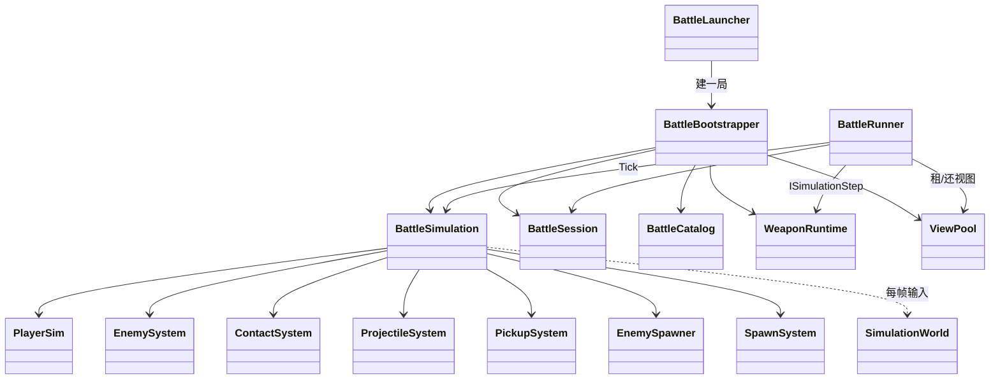
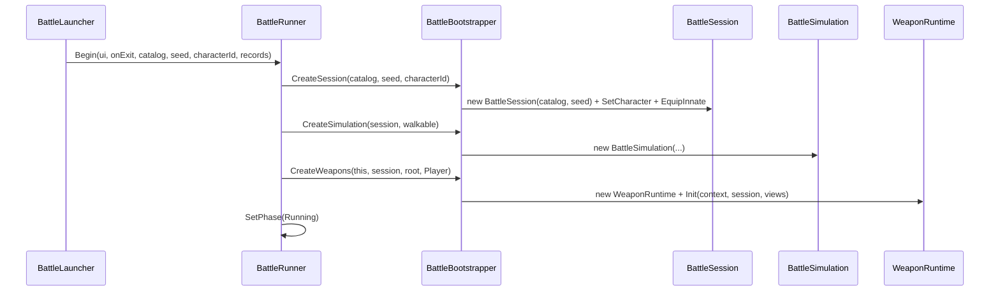
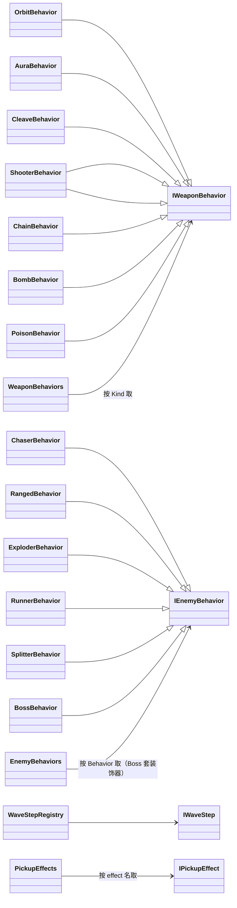
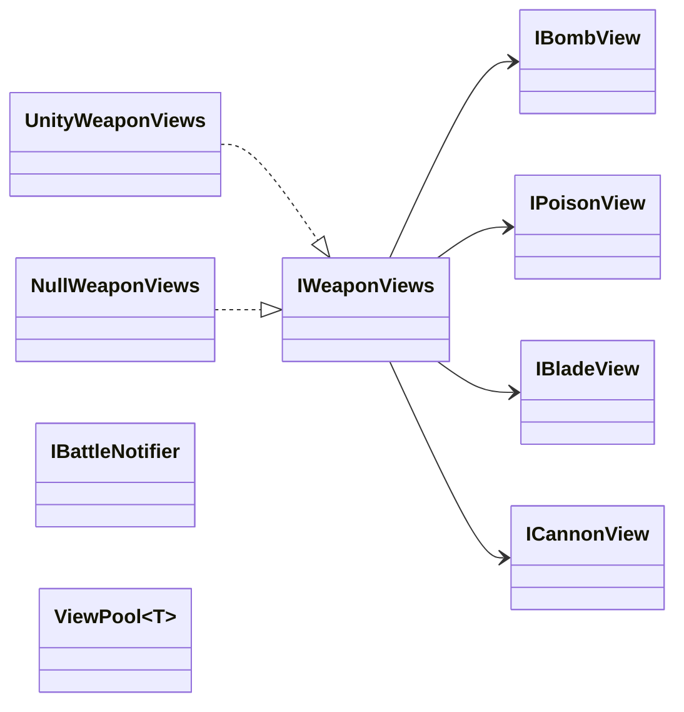
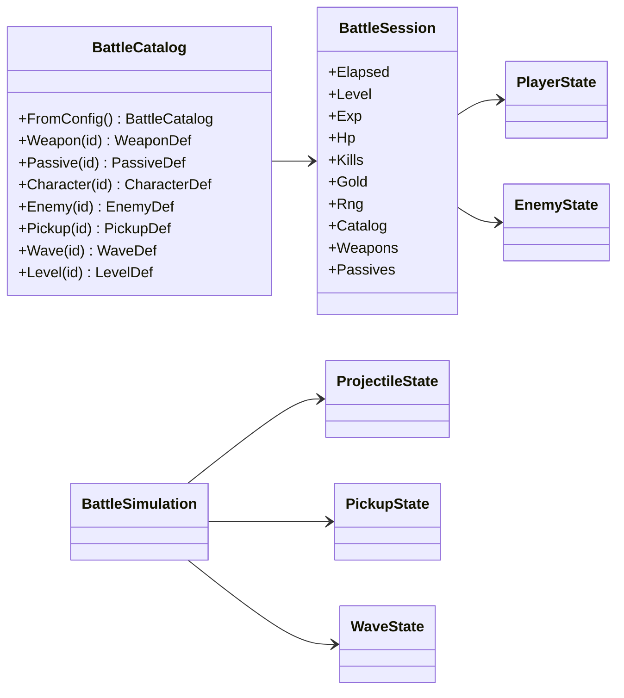
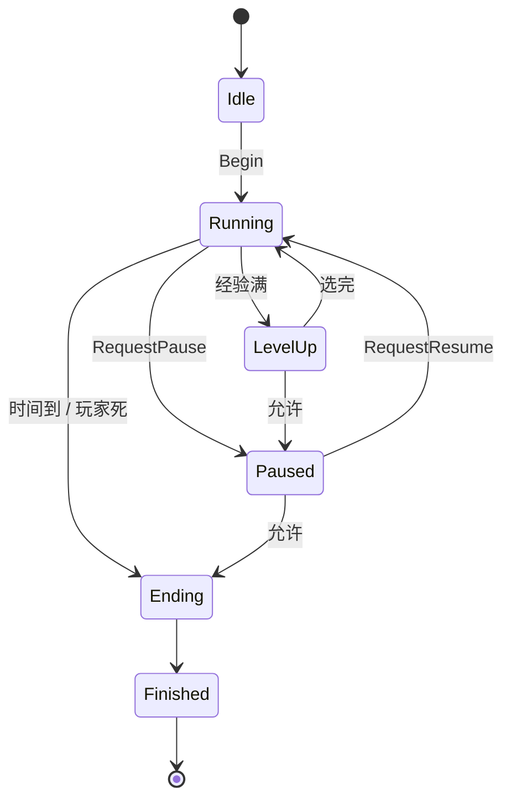
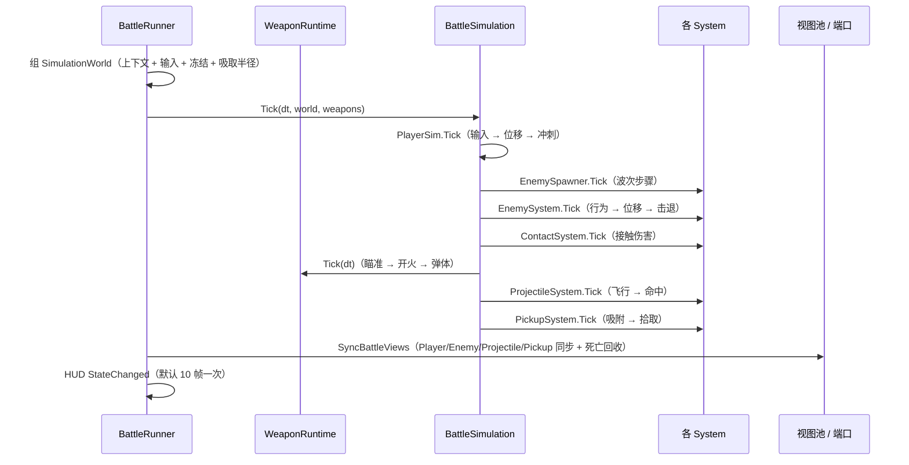

# 战斗系统类图

> 对应代码：`Client/Assets/App/Battle/`（104 个 .cs；`BattleRunner` 是 1 个主文件 + 6 个 partial 共 7 个文件）、
> `Client/Assets/App/UI/Battle/`（7 个界面脚本）、`Client/Assets/App/Config/BattleDefs.cs`（配置类型）。
> 图用 Mermaid 写，GitHub / VS Code（Markdown Preview Mermaid）能直接渲染；每张图后面有文字补充。
> **签名以代码为准**，本文只保证「职责、依赖方向、生命周期」不漂移；逐文件说明见
> [`Assets/App/Battle/战斗系统.md`](../Assets/App/Battle/战斗系统.md)。

---

## 1. 分层总览

依赖只允许向下：`BattleLauncher → BattleBootstrapper → BattleRunner → BattleSimulation → 各 System → State`。
`BattleSimulation` 不认识 `Transform` / 相机 / HUD；`BattleRunner` 不认识各 System 的构造参数（那是组合根的事）。

---

## 2. 开始一局（组合根）

`BattleRunner.Begin` 只做「拿到零件并按顺序装起来」，具体构造参数（角色、本命武器、波次表、拾取效果、视图实现）
都在 `BattleBootstrapper` 里；换美术实现（`UnityWeaponViews` ↔ `NullWeaponViews`）也只动组合根。

`SimulationWorld` 是**一帧的输入包**（值类型，`readonly struct`）：
`Waves` / `Projectiles` / `Pickups` / `Enemies` 四个窄上下文 + `EnemyStates`（权威列表）+ `Input` +
`Walkable` + `Frozen` + `MagnetRadius`。四个上下文按消费者拆开，各系统看不到自己用不上的副作用。

---

## 3. 规则层：窄上下文接口

| 接口 | 成员 | 实现者 | 使用方 |
|---|---|---|---|
| `IWeaponContext` | 6 | `BattleRunner` | `WeaponRuntime`、8 个武器行为、`CannonMount` |
| `IEnemyContext` | 9 | `BattleRunner` | `EnemySystem`、`ContactSystem`、敌人行为（含 `BossBehavior`） |
| `IProjectileContext` | 6 | `BattleRunner` | `ProjectileSystem` |
| `IPickupContext` | 6 | `BattleRunner` | `PickupSystem`、`IPickupEffect` 实现 |
| `IWaveContext` | 7 | `BattleRunner` | `IWaveStep` 实现、`EnemySpawner` |

`BattleRunner` 同时实现这五个接口（它站在表现层与规则层之间），但**每个消费者只拿到自己那个**。
规则层因此不引用 `MonoBehaviour`：给一套纯数据实现，就能在没有场景的情况下跑 `BattleSimulation`。

---

## 4. 扩展点：注册表 + 行为

加内容只加注册项：新武器形态 = 实现 `IWeaponBehavior` + `WeaponBehaviors` 注册一行；新敌人行为 = `IEnemyBehavior`
+ `EnemyBehaviors`；新波次 = `IWaveStep` + `WaveStepRegistry`；新拾取效果 = `IPickupEffect` + `PickupEffects`。
`EnemySystem` 里**没有** `if (IsBoss)`：二阶段是 `BossBehavior` 装饰在走位行为外面（P2-4）。

`WeaponRuntime : ISimulationStep` 是唯一参与模拟的「子系统之外的子系统」：
`BattleSimulation.Tick(deltaTime, world, weapons)` 只按顺序调它，不知道武器怎么开火。

---

## 5. 表现层：端口 + 视图池

- 规则层想放特效时只说意图：`Views.Flash(...)`、`Views.Fan(...)`、`Views.CreateBlade(...)`、`Views.SetCharge(...)`。
  `UnityWeaponViews` 把它们翻译成 `TransientFx` / `SpriteRenderer` / `CannonRig` 调用，`NullWeaponViews` 全空实现 ——
  这就是 headless 能跑的原因（P0-1）。
- `IBattleNotifier` 同理：`BossBehavior` 只 `Notify("...")`，具体是 Toast 还是别的由 `ToastBattleNotifier` 决定（P1-3）。
- **视图不能反向喂逻辑**：炮口位置曾经由 `CannonRig` 算（吃 `Time.deltaTime`），弹体出生点于是随帧率漂移，
  同种子两局结果不同。现在位姿由 `CannonMount`（逻辑）算，`CannonRig.SetPose(bodyPosition, direction)` 只摆外观。
- `ViewPool<T>`（`ViewPools.cs`）统一租/还敌人、弹体、拾取物；`TransientFx` / `LightningFx` 自带静态池。
  借用方必须实现 `ClearState()`（或在 `Init` 里重置），否则复用会带出上一只的闪白、排序号与缩放。

---

## 6. 数据模型

- 配表静态类（`WeaponDef.All` 等）只在**启动时**被 `BattleCatalog.FromConfig()` 读一次，运行期一律走
  `Session.Catalog`；测试可以塞一份自己的目录，不碰全局静态表（P2 收口）。
- `BattleSession` 是**只读门面**：列表是 `IReadOnlyList`，属性 `private set`，升级/进化只走
  `TryUpgradeWeapon/TryUpgradePassive`，冷却只走 `AdvanceCooldown/ResetCooldown/ClearCooldown`。
- 各 `State` 是纯数据（位置、血量、计时、相位），不含任何 Unity 对象；表现层单向读它。

---

## 7. 流程状态机

合法转移写在 `BattlePhaseRules.CanTransition`，唯一写入口是 `BattleRunner.SetPhase`。
`LevelUp → Ending` **不允许**（升级面板必须先处理完）；`Paused` 是独立状态，不是 `Running` 上的布尔位；
只有 `Running` 不 `BlocksSimulation`。

---

## 8. 一帧的调用时序（`Running`）

顺序是数据的一部分：调换会改变随机流与手感，改之前先看 `BattleSimulation.Tick` 顶部注释。
`SyncBattleViews` 的第一行是 `Player.SyncFromState(deltaTime)` —— 漏掉它会出现「输入正常但精灵和相机不动」。

---

## 9. 依赖红线（评审时按这条查）

| 允许 | 禁止 |
|---|---|
| 表现层读 `State` | 规则层读 `Transform` / `Camera` / `HUD` |
| 规则层通过 `I*Context` 提请求 | 规则层 `new GameObject`、`Instantiate`、`AddComponent` |
| 规则层通过 `IWeaponViews` 要特效 | 规则层直接调 `TransientFx` / `CannonRig` |
| 组合根 `new` 具体实现 | 业务代码 `new` 系统（会绕过注入与池） |
| 静态配表在启动时读一次 | 运行期 `WeaponDef.Get(...)`（改走 `Session.Catalog`） |
| 逻辑随机用 `Session.Rng` | 逻辑随机用 `UnityEngine.Random`（会被表现层带偏） |
